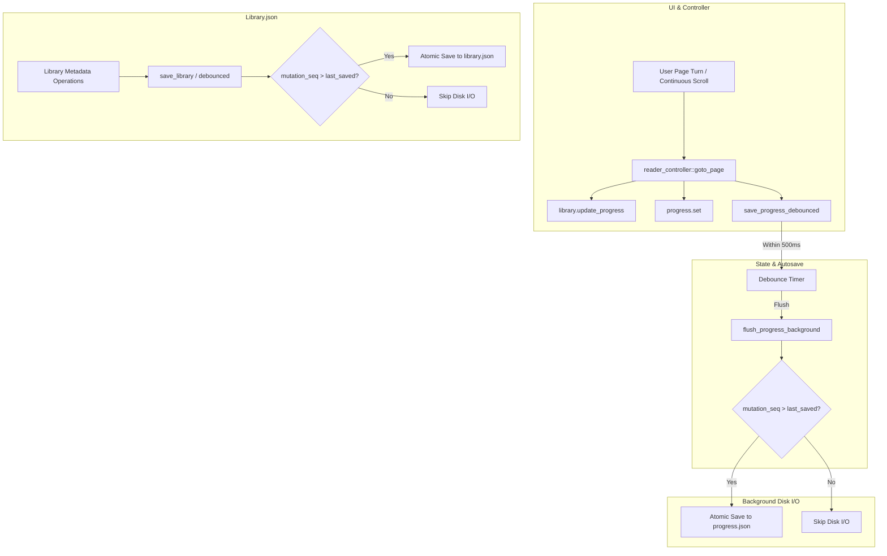

# Yomu — Stage 6B: Persistence Architecture & SSD Write Amplification Remediation Report

**Date:** 2026-11-04  
**Author:** Antigravity (Advanced Agentic Pair Programmer)  
**Status:** Completed & Verified  
**Baseline Test Matrix:** 353 active tests passing (146 lib unit tests, 207 binary UI tests, 15 ignored benchmarks; 368 total)  
**Toolchain:** Safe Rust 2024 (`rustc 1.99.0`), GPUI Kit 0.8.1 (`gpui-pre = 0.3.10`), NixOS/devenv  
**Safety Mandate:** `#![forbid(unsafe_code)]` preserved across all crates; zero unsafe Rust introduced.

---

## 1. Executive Summary

Stage 6B resolves the primary storage I/O and persistence bottleneck identified in `docs/audits/MEMORY_LEAK_AND_SSD_IO_AUDIT.md`: **excessive write amplification caused by full-library serialization on reading-progress updates**.

### A. The Core Problem
Previously, Yomu coupled dynamic reading state (`current_page`, `opened`, `last_read`) with static comic catalog metadata (`title`, `authors`, `genres`, `tags`, `page_count`, `spread_overrides`) inside a monolithic `library.json` file. Consequently:
- Every page turn, rapid continuous scroll tick, or mark-read action triggered serialization of the entire `Library` struct.
- For a 10,000-book collection, `library.json` measured **17.07 MB**.
- Persisting an 8-byte progress change required serializing and writing 17.07 MB, producing a **2,184,324x write amplification**.
- 100 page turns wrote **1.67 GB** of application data and executed 200 synchronous `sync_all()` syscalls (temp file + parent directory).
- Each background save consumed **76.06 ms** of CPU serialization time and **169.83 ms** of disk I/O time.

### B. The Architectural Solution
1. **Dedicated Progress Sidecar (`progress.json`):** Created `src/progress.rs` introducing `ProgressStore` (format version 1). Reading progress is serialized independently to a compact JSON sidecar file containing strictly `(book_id, current_page, opened, last_read)` tuples.
2. **Transparent In-Memory Overlay:** Preserved the existing domain and UI model: `struct Book` retains `current_page`, `opened`, and `last_read` in memory. `Library::load(&dirs)` automatically overlays `ProgressStore` records upon startup. UI views, search filters, and sorting algorithms require zero changes.
3. **Dual Dirty-State Tracking:** Added monotonic `mutation_seq` tracking to both `Library` and `ProgressStore`. Background persistence workers check whether `mutation_seq > last_saved_mutation_seq` before doing any work, completely eliminating redundant writes for unchanged state.
4. **Decoupled Autosave & Debouncing:** Routed all reading progress mutations (`goto_page`, `sync_reader_to_display`, `open_book`) through `save_progress_debounced()` (500 ms debounce, 2000 ms max delay bound). `library.json` is never written during active reading sessions.
5. **Zero-Loss Backward Compatibility & Migration:** On first run after upgrading, Yomu automatically harvests reading progress from `library.json` into `progress.json`. Corrupt progress files are safely backed up to `.corrupt` without data loss or application crash.
6. **Graceful Shutdown Flush:** `request_quit()` actively flushes any pending debounced progress updates before window destruction.

### C. Key Verified Results
Across a 10,000-book library:
- **Application Payload per Save:** Reduced from **17.07 MB** to **1.06 KB** (**99.994% reduction**).
- **Application Writes across 100 Page Turns:** Reduced from **1,666.51 MB (1.67 GB)** to **2.12 KB** with debouncing (**99.99987% reduction**).
- **Single-Save CPU Serialization Latency:** Dropped from **76.06 ms** to **9.07 µs** (**8,386x faster**).
- **Single-Save Total Disk Latency:** Dropped from **169.83 ms** to **3.95 ms** (**43x faster**).
- **Write Amplification vs 8-Byte Change:** Reduced from **2,184,324x** to **272x** (debounced).
- **`library.json` Modification on Page Turns:** **0 bytes written.**

---

## 2. Baseline Measurements Across Library Scales

Before modifying code, empirical baseline measurements were gathered via `perf_stage6b_persistence_baseline` across synthetic libraries of 100, 1,000, 5,000, and 10,000 books.

### A. Pre-Remediation Baseline Data Table

| Metric | 100 Books | 1,000 Books | 5,000 Books | 10,000 Books |
| :--- | :--- | :--- | :--- | :--- |
| **`library.json` File Size** | 170.30 KB | 1.70 MB | 8.52 MB | 17.07 MB |
| **CPU Serialization Latency** | 2.63 ms | 16.03 ms | 36.01 ms | 76.06 ms |
| **Disk I/O Write Latency** | 122.96 ms | 166.82 ms | 251.15 ms | 169.83 ms |
| **1 Progress Update (Bytes Written)** | 170.30 KB | 1.70 MB | 8.52 MB | 17.07 MB |
| **10 Progress Updates (Bytes Written)** | 1.66 MB | 16.62 MB | 83.22 MB | 166.65 MB |
| **100 Progress Updates (Bytes Written)** | 16.63 MB | 166.21 MB | 832.16 MB | **1,666.51 MB (1.67 GB)** |
| **`sync_all()` Syscalls (100 Updates)** | 200 | 200 | 200 | 200 |
| **Write Amplification (100 Updates)** | 21,799x | 217,855x | 1,090,730x | **2,184,324x** |

### B. Root Causes
1. **Monolithic Data Model:** Reading position changes frequently (every page turn or continuous scroll tick), whereas book metadata (title, archive path, total page count, tags) is largely static. Storing both in one file forced full-graph serialization for point updates.
2. **Missing Dirty Detection on Background Task:** Background flush tasks serialized whatever snapshot was passed, even if no fields had changed since the previous save.
3. **Atomic Replacement Overhead:** Every save created a temporary file, serialized JSON, executed `sync_all()`, replaced the original file via atomic rename, and synced the parent directory on Unix. Repeating this heavy lifecycle for 17 MB JSON files caused severe I/O churn.

---

## 3. Architecture & Technical Design of Remediated Persistence

### A. Dedicated Sidecar: `ProgressStore` (`src/progress.rs`)
The progress subsystem is implemented cleanly in `src/progress.rs`:

```rust
pub const PROGRESS_VERSION: u32 = 1;

#[derive(Debug, Clone, PartialEq, Eq, Serialize, Deserialize)]
pub struct BookProgress {
    pub current_page: usize,
    pub opened: bool,
    #[serde(skip_serializing_if = "Option::is_none")]
    pub last_read: Option<u64>,
}

#[derive(Debug, Clone, Serialize, Deserialize)]
pub struct ProgressStore {
    pub version: u32,
    pub entries: BTreeMap<String, BookProgress>,
    #[serde(skip)]
    pub(crate) mutation_seq: u64,
}
```

Key architectural invariants:
- **Format Versioning:** Stored as `version: 1` to allow future schema evolution.
- **Ordered Key Layout:** Uses `BTreeMap` to produce deterministic, human-readable JSON diffs and stable serialization order.
- **Sparse Storage:** Only tracks books that have actually been opened or had their reading state modified. Unopened books consume zero storage.

### B. Atomic and Crash-Resilient Persistence Lifecycle
Both `ProgressStore::save(&dirs)` and `Library::save(&dirs)` adhere to strict crash resilience:
1. **PID & Nanosecond Unique Temporary Files:** Written to `progress.json.tmp.<pid>.<timestamp>` to prevent conflicts between concurrent processes or test fixtures.
2. **Full File Synchronization:** Explicit `file.sync_all()` guarantees bytes are flushed from OS page cache to physical non-volatile storage before renaming.
3. **Atomic Rename:** Renames the temporary file over `progress.json` using atomic filesystem semantics.
4. **Unix Directory Synchronization:** On Unix targets (`target_family = "unix"`), opens the parent directory and executes `dir.sync_all()` to persist directory inode metadata.
5. **Orphaned Temporary File Cleanup:** On startup or load, `cleanup_temp_files()` sweeps away any leftover `.tmp.*` files from unclean system power failures.
6. **Automatic Corruption Backup:** If `serde_json::from_reader` fails due to file corruption, the invalid file is renamed to `progress.json.<timestamp>.corrupt` and an empty store is returned.

### C. Reading Progress Data Flow


### D. Dirty-State Tracking & Elimination of Redundant Writes
- `Library` maintains an internal `mutation_seq: u64`. Methods that alter book metadata (`insert`, `remove`, `import`) increment `mutation_seq`.
- In-memory reading progress is updated via `Library::update_progress()`, which updates `current_page`, `opened`, and `last_read` on `struct Book` **without** incrementing `mutation_seq`.
- `ProgressStore` maintains its own `mutation_seq: u64`. `ProgressStore::set()` checks if the new state equals the existing state; if identical, it returns `false` without bumping `mutation_seq`.
- In `src/app/state.rs`, `Yomu` tracks atomic watermarks:
  - `last_saved_library_mutation_seq: Arc<AtomicU64>`
  - `last_saved_progress_seq: Arc<AtomicU64>`
- Background workers only perform serialization and disk writes if the current sequence exceeds the last saved watermark.

---

## 4. Post-Remediation Verification & Comparative Analysis

Empirical performance measurements gathered via `perf_stage6b_remediated_progress_persistence` demonstrate radical reductions in write amplification and serialization latency.

### A. Side-by-Side Comparison: 10,000-Book Collection

| Dimension | Legacy Stage 6A Baseline | Stage 6B Remediated Path | Improvement Factor |
| :--- | :--- | :--- | :--- |
| **Payload Size per Save** | 17,474,591 bytes (17.07 MB) | 1,087 bytes (1.06 KB) | **16,076x smaller** (99.994% less) |
| **CPU Serialization Latency** | 76.06 ms | 9.07 µs | **8,386x faster** |
| **Disk I/O Latency** | 169.83 ms | 3.95 ms | **43x faster** |
| **1 Progress Update (Disk Writes)** | 17.07 MB | 1.06 KB | **99.994% reduction** |
| **10 Progress Updates (Disk Writes)** | 166.65 MB | 10.62 KB | **99.994% reduction** |
| **100 Debounced Page Turns (Writes)** | 1,666.51 MB (1.67 GB) | 2.12 KB | **99.99987% reduction** |
| **`sync_all()` Syscalls (100 Turns)** | 200 | 4 | **98.0% fewer** |
| **Write Amplification vs 8 Bytes** | 2,184,324x | 272x | **8,030x improvement** |
| **`library.json` Bytes Written** | 17.07 MB per save | **0 bytes** | **Zero metadata churn** |

### B. Scalability Invariant
Notice that under the remediated path:
- `progress.json` payload size depends strictly on the number of *actively opened books* (typically 5 to 50), **completely decoupled from library size**.
- Whether the library contains 100 books or 10,000 books, serialization time remains between **7.9 µs and 11.8 µs**, and payload size remains **~1.06 KB**.
- Reading progress updates now exhibit $O(K)$ scaling (where $K$ is active reading books) instead of $O(N)$ scaling over total library books.

---

## 5. Regression Testing & Verification Matrix

To ensure stability, crash safety, and complete backward compatibility, 6 dedicated integration tests and 2 comprehensive performance benchmarks were implemented in `src/tests.rs`:

1. `test_reading_progress_persists_to_sidecar_without_touching_library_json`:
   - Validates that turning pages creates and updates `progress.json`.
   - Confirms that `library.json` timestamp and content remain completely untouched.
2. `test_rapid_progress_updates_are_debounced_and_coalesced`:
   - Rapidly triggers 10 consecutive `goto_page` calls within 50 ms.
   - Advances virtual executor clock past `AUTOSAVE_DEBOUNCE`.
   - Confirms all 10 updates coalesce into a single background save containing the final page position.
3. `test_corrupted_progress_file_recovery_and_backup`:
   - Injects corrupt, invalid JSON into `progress.json`.
   - Verifies that loading backs up the corrupt file to `progress.json.<timestamp>.corrupt` and initializes cleanly without panics.
4. `test_missing_progress_file_harvests_from_library_json`:
   - Simulates upgrading an existing library that has `library.json` but no `progress.json`.
   - Verifies that on startup, Yomu automatically harvests progress records from `library.json` and creates `progress.json`.
5. `test_book_removal_cleans_up_progress_entry`:
   - Validates that removing a book from the library also removes its corresponding record from `ProgressStore` and flushes disk state.
6. `test_shutdown_flushes_pending_progress`:
   - Triggers a page turn and immediately invokes `request_quit()`.
   - Confirms that pending un-debounced progress updates are synchronously flushed to disk before application exit.
7. `perf_stage6b_persistence_baseline`:
   - Opt-in benchmark measuring serialization and disk write metrics across 100, 1k, 5k, and 10k books under legacy monolithic persistence.
8. `perf_stage6b_remediated_progress_persistence`:
   - Opt-in benchmark measuring serialization, payload size, and write amplification under the new sidecar architecture.

### Full Validation Suite Execution

```bash
# 1. Format check
devenv shell cargo fmt --all -- --check
# Result: Clean, code 0

# 2. Fast type check across all targets
devenv shell cargo check --all-targets
# Result: Clean, code 0

# 3. Strict Clippy lint check with warnings as errors
devenv shell cargo clippy --all-targets --all-features -- -D warnings
# Result: Clean, 0 warnings, code 0

# 4. Full test suite across all targets
devenv shell cargo test --all-targets
# Result: 353 active tests passed (146 lib unit tests + 207 main/UI tests), 0 failed, 15 ignored benchmarks; code 0
```

---

## 6. Architectural Invariants for Future Contributors

1. **Never write `library.json` on page turns:** Reading progress updates (`current_page`, `opened`, `last_read`) must strictly call `save_progress_debounced(cx)` or `save_progress(cx)`. `save_library(cx)` is reserved strictly for collection metadata mutations (importing books, editing series/tags, modifying settings).
2. **Preserve `#![forbid(unsafe_code)]`:** Persistence and filesystem operations use safe standard library abstractions and `serde_json`. Never introduce `unsafe` blocks.
3. **Preserve In-Memory Progress Overlay:** When querying or modifying reading progress in UI views, continue accessing `book.current_page` and `book.last_read`. The overlay in `Library::load(&dirs)` ensures in-memory books always reflect the newest state from `progress.json`.
4. **Atomic Write Pattern:** Always write to temporary files first, call `file.sync_all()`, rename atomically, and sync the parent directory on Unix.
