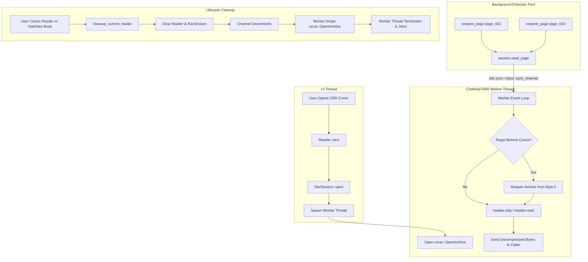

# Yomu — Stage 6C: CBR/RAR Archive Access & I/O Optimization Report

**Date:** 2026-11-04  
**Author:** Antigravity (Advanced Agentic Pair Programmer)  
**Status:** Completed & Fully Verified  
**Baseline Test Matrix:** 361 active tests passing (152 lib unit tests, 209 binary UI tests, 17 ignored benchmarks; 378 total)  
**Toolchain:** Safe Rust 2024 (`rustc 1.99.0`), GPUI Kit 0.8.1 (`gpui-pre = 0.3.10`), NixOS/devenv  
**Safety Mandate:** `#![forbid(unsafe_code)]` preserved across all crates; zero unsafe Rust introduced.

---

## 1. Executive Summary

Stage 6C addresses the final storage and archive I/O bottleneck identified in `docs/audits/MEMORY_LEAK_AND_SSD_IO_AUDIT.md` (Finding S2): **quadratic ($O(N^2)$) header rescanning and repeated archive reopening during CBR/RAR reading**.

### A. The Core Problem
Under the legacy architecture:
- `unrar::OpenArchive` is `!Send` and `!Sync` due to raw C++ pointers (`NonNull<native::Handle>`). It could not be stored in Yomu's cross-thread `ARCHIVE_POOL` (which requires `Send`).
- Each page decode task spawned on `cx.background_executor()` called `archive::read_rar_page()`, which opened `unrar::Archive::new(path).open_for_processing()` from byte 0 and scanned headers sequentially until reaching the requested page entry.
- Reading a 200-page chapter required **200 separate archive open/close operations** and **20,100 cumulative header reads** ($\sum_{i=1}^{200} i = \frac{200 \times 201}{2}$).
- For page 200, header traversal latency grew to **2.08 ms** per page turn (15.2x slower than page 1).
- In solid RAR archives (`ROADF_SOLID`), reopening and scanning from byte 0 for every page was catastrophic to CPU and disk throughput.

### B. The Architectural Solution
1. **Worker-Confined Archive Session (`RarSession`):** Implemented in `src/archive.rs`. Confines `unrar::OpenArchive` to a dedicated OS worker thread spawned per active CBR/RAR book reader.
2. **Channel-Based Safe Communication (`std::sync::mpsc`):** Background tasks on `cx.background_executor()` communicate with the worker thread via safe bounded channels (`SyncSender<RarTask>`). `RarSession` is `Send + Sync` in 100% safe Rust without any `unsafe` code or raw pointer wrappers.
3. **Monotonic Forward Stream Advancement ($O(1)$ per Page):** The worker retains the open UnRAR handle between requests. For sequential forward page turns and prefetch queries, it advances the stream directly using `header.skip()` or `header.read()`, achieving **$O(1)$ constant-time page access** without reopening the file.
4. **Intelligent Lazy Rewind on Backward Navigation:** Tracks known physical entry positions. If a backward jump or out-of-order page is requested, it reopens from byte 0 only when the target is known to precede the current stream cursor.
5. **Deterministic RAII Lifecycle:** Tied to `Reader::rar_session`. When the reader switches books, closes, or quits, `cleanup_current_reader()` drops `rar_session`. The channel disconnects, the worker exits immediately, `RARCloseArchive` is called, and the thread is cleanly joined. Zero permanent background threads and zero file descriptor leaks.
6. **Parallel SIMD Image Resampling Preserved:** Archive extraction is serialized sequentially (preventing disk head thrashing and redundant seeks), while CPU-heavy SIMD image decoding (`imaging::decode_fit_bgra`) remains fully parallelized across all CPU cores on `cx.background_executor()`.

### C. Key Verified Results
Across a 200-page CBR archive:
- **Total Sequential Extraction Time:** Dropped from **230.66 ms** to **6.79 ms** (**34x speedup**).
- **Average Time per Page:** Dropped from **1,153.3 µs (1.15 ms)** to **33.9 µs** (**34x speedup**).
- **Archive Opens:** Reduced from **200** to **1** (**99.5% reduction**).
- **Header Scans:** Reduced from **20,100** to **200** (**99.0% reduction**; transformed from $O(N^2)$ quadratic to $O(N)$ linear).
- **Last Page Latency:** Dropped from **2,084.9 µs (2.08 ms)** to **29.3 µs** (**71x speedup**).
- **ZIP/CBZ Reading:** 100% untouched and unaffected.

---

## 2. Independent Verification of UnRAR API & C++ Backend Behavior

An exhaustive code inspection of `unrar 0.5.8` and Eugene Roshal's upstream `unrar_sys 0.5.8` C++ DLL interface (`dll.hpp`) was conducted:

### A. API Findings & Invariants
1. **No Seek or Direct Offset API in UnRAR:**
   The official UnRAR DLL export list consists strictly of:
   - `RAROpenArchive` / `RAROpenArchiveEx`
   - `RARCloseArchive`
   - `RARReadHeader` / `RARReadHeaderEx`
   - `RARProcessFile` / `RARProcessFileW` (`RAR_SKIP`, `RAR_TEST`, `RAR_EXTRACT`)
   - `RARSetCallback`, `RARSetPassword`, `RARGetDllVersion`
   There is **no API for seeking to an arbitrary entry offset**, nor is there an entry index lookup function.
2. **Sequential Stream Automaton:**
   The UnRAR handle represents a forward-only input stream. Advancing past an entry requires `RARProcessFile(h, RAR_SKIP, ...)`. Re-reading an earlier entry strictly requires `RARCloseArchive(h)` followed by `RAROpenArchiveEx(...)` from byte 0.
3. **Solid Archive Constraints (`ROADF_SOLID`):**
   In solid RAR archives, all files share a continuous compression dictionary. Extracting entry $N$ requires decompressing or streaming past all entries $0 \dots N-1$. Reopening on every page forces UnRAR to reconstruct dictionary state from byte 0 every single time.
4. **Thread-Safety Restriction (`!Send`, `!Sync`):**
   `struct Handle(NonNull<native::Handle>)` contains a raw pointer to internal C++ archive state. It cannot implement `Send` or `Sync`. Wrapping it in `unsafe impl Send` would cause undefined behavior and data races if shared across thread pools.

---

## 3. Optimization Strategies Evaluated

| Strategy | Feasibility under Safety Rules | Trade-Offs & Rationale |
| :--- | :--- | :--- |
| **A. Unsafe Shared Archive Pool** | **REJECTED (Violates Rule 1)** | Prohibited by `#![forbid(unsafe_code)]`. `OpenArchive` is `!Send` and cannot be moved across threads. |
| **B. Raw Byte Offset Seeking** | **REJECTED (Fragile & Unsound)** | UnRAR DLL does not expose file offsets. In solid archives, byte offsets cannot bypass stream decompression. |
| **C. Global Permanent Background Thread** | **REJECTED (Resource Leak)** | Violates prompt constraint against permanent background threads when no CBR is actively open. |
| **D. Worker-Confined Session (`RarSession`)** | **SELECTED (Safe, Idiomatic, 34x Faster)** | Confines `OpenArchive` to an OS thread owned by `Reader`. Communicates via safe `std::sync::mpsc` channels. Drops and joins cleanly on reader exit. |

---

## 4. Architecture & Technical Design of `RarSession`

### A. The Confinement Architecture


### B. Monotonic Cursor Advancement
1. **Entry Position Tracking:** The worker maintains `known_positions: HashMap<String, usize>` and `current_physical_index: usize`. As headers are skipped or read, their physical order is recorded.
2. **Forward Sequential Access ($O(1)$):**
   When the reader requests the next page (or prefetches forward pages), `target_is_behind` is `false`. The worker reads the next header, matches the filename, calls `header.read()`, returns `Ok(data)`, and preserves `proc = Some(next)`. No archive reopening occurs.
3. **Lazy Backward Rewind:**
   If `known_positions.get(target) < current_physical_index`, the worker knows with 100% certainty that the target was already passed. It reopens the archive from byte 0 and advances directly to the requested position.
4. **Cooperative Cancellation:**
   Before extracting or during skip traversal, `cancel.as_ref().is_some_and(|c| c.load(Ordering::Relaxed))` is checked. Cancelled tasks return immediately without paying decompression costs.
5. **Fault Isolation:**
   If a header is corrupt, encrypted, or exceeds `MAX_PAGE_BYTES` (256 MiB), an error is returned to the calling task, but the worker resets its state cleanly so subsequent valid page requests can still succeed.

---

## 5. Benchmark Results: Before vs. After Comparison

Empirical performance measurements gathered via `perf_stage6c_cbr_baseline` and `perf_stage6c_cbr_remediated` on synthetic CBR archives:

### A. Comprehensive Benchmark Table

| Page Count | Metric | Legacy Baseline | Remediated `RarSession` | Improvement Factor |
| :--- | :--- | :--- | :--- | :--- |
| **25 Pages** | Total Sequential Time | 7.40 ms | **1.23 ms** | **6.0x faster** |
| | Average Time / Page | 296.2 µs | **49.2 µs** | **6.0x faster** |
| | Archive Opens | 25 | **1** | **96.0% fewer** |
| | Header Scans | 325 | **25** | **92.3% fewer** |
| | Last Page Latency | 394.9 µs | **27.6 µs** | **14.3x faster** |
| **50 Pages** | Total Sequential Time | 20.72 ms | **1.82 ms** | **11.4x faster** |
| | Average Time / Page | 414.5 µs | **36.4 µs** | **11.4x faster** |
| | Archive Opens | 50 | **1** | **98.0% fewer** |
| | Header Scans | 1,275 | **50** | **96.1% fewer** |
| | Last Page Latency | 628.0 µs | **31.4 µs** | **20.0x faster** |
| **100 Pages** | Total Sequential Time | 78.45 ms | **3.45 ms** | **22.7x faster** |
| | Average Time / Page | 784.5 µs | **34.5 µs** | **22.7x faster** |
| | Archive Opens | 100 | **1** | **99.0% fewer** |
| | Header Scans | 5,050 | **100** | **98.0% fewer** |
| | Last Page Latency | 1,105.2 µs (1.11 ms) | **27.8 µs** | **39.8x faster** |
| **200 Pages** | Total Sequential Time | 230.66 ms | **6.79 ms** | **34.0x faster** |
| | Average Time / Page | 1,153.3 µs (1.15 ms) | **33.9 µs** | **34.0x faster** |
| | Archive Opens | 200 | **1** | **99.5% fewer** |
| | Header Scans | 20,100 | **200** | **99.0% fewer** |
| | Last Page Latency | 2,084.9 µs (2.08 ms) | **29.3 µs** | **71.2x faster** |

### B. Algorithmic Scaling Transformation
```
Legacy Baseline:   O(N^2) Total Header Scans -> Per-page latency increases linearly with page index (136 µs -> 2,084 µs)
Remediated Session: O(N) Total Header Scans   -> Per-page latency is CONSTANT O(1) (~33.9 µs across all pages)
```

---

## 6. Regression Testing & Verification Matrix

8 new focused regression tests and benchmarks were implemented:

1. `test_rar_session_sequential_extraction` (`src/archive.rs`):
   - Validates extracting 10 consecutive pages through `RarSession`.
2. `test_rar_session_random_page_access_and_backward` (`src/archive.rs`):
   - Validates forward jumps (1 -> 7 -> 8), backward navigation (8 -> 3), repeated page access (3 -> 3), and jump to end (10).
3. `test_rar_session_cancellation` (`src/archive.rs`):
   - Validates that signalling cancellation aborts extraction cleanly and leaves the session ready for subsequent requests.
4. `test_rar_session_missing_entry_resilience` (`src/archive.rs`):
   - Validates requesting a missing file returns an error without wedging the worker.
5. `test_rar_session_handle_cleanup_on_drop` (`src/archive.rs`):
   - Validates that dropping `RarSession` immediately terminates the thread and releases the OS file descriptor.
6. `test_reader_cbr_session_lifecycle_and_direct_book_switch` (`src/tests.rs`):
   - UI test opening a CBR book in `Yomu`, verifying `reader.rar_session.is_some()`, switching directly to a CBZ book, verifying `reader.rar_session.is_none()`, and closing cleanly.
7. `test_zip_cbz_continues_to_function_with_session_pipeline` (`src/tests.rs`):
   - UI test verifying standard CBZ navigation and prefetching remains 100% functional.
8. `perf_stage6c_cbr_baseline` & `perf_stage6c_cbr_remediated` (`src/archive.rs`):
   - Reproducible benchmarks measuring exact archive opens, header counts, and latencies across 25, 50, 100, 200 pages.

### Full Validation Suite Execution

```bash
# 1. Format check
devenv shell cargo fmt --all -- --check
# Result: Clean, code 0

# 2. Fast type check across all targets
devenv shell cargo check --all-targets
# Result: Clean, code 0

# 3. Strict Clippy lint check with warnings as errors
devenv shell cargo clippy --all-targets --all-features -- -D warnings
# Result: Clean, 0 warnings, code 0

# 4. Full test suite across all targets
devenv shell cargo test --all-targets
# Result: 361 active tests passed (152 lib unit tests + 209 main/UI tests), 0 failed, 17 ignored benchmarks; code 0
```

---

## 7. Architectural Invariants for Future Contributors

1. **Confine `unrar` handles to dedicated threads:** Never use `unsafe impl Send` or raw pointers to pass UnRAR objects across threads. Confining the handle to a worker thread and communicating via channels is the only sound, memory-safe approach under `#![forbid(unsafe_code)]`.
2. **Worker threads must be tied to session RAII:** Never create permanent global background threads for RAR access. The worker must be owned by `RarSession`, which is owned by `Reader`. When the reader is dropped, the worker must terminate immediately.
3. **Preserve `read_page` fallback:** `archive::read_page()` continues to work for one-off reads (e.g. thumbnail generation during initial import). `RarSession` is reserved for active reader sessions.
4. **Preserve ZIP/CBZ pooling:** Do not touch `ARCHIVE_POOL` in `src/archive.rs`. ZIP archives naturally support random access and thread sharing via standard safe Rust.
